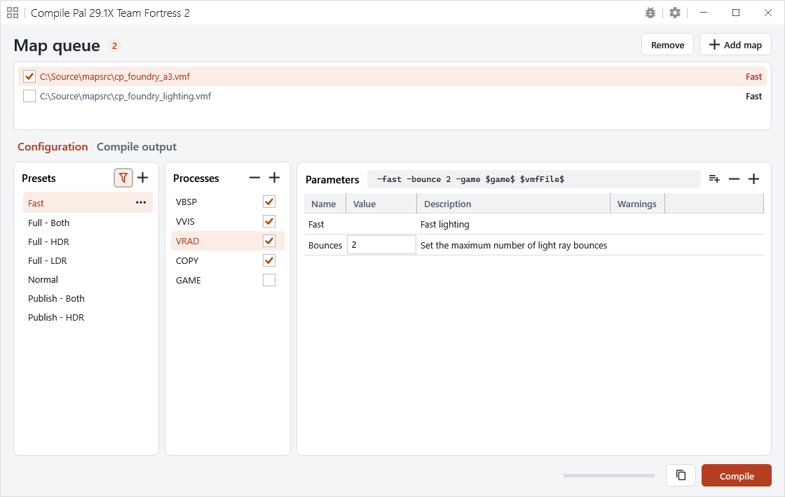

	

Compile Pal is an easy to use wrapper for the Source Engine map compiling tools.

<picture>
  <source media="(prefers-color-scheme: dark)" srcset="Guides/images/workspace-dark.png">
  
</picture>

Compile Pal follows your Windows app color setting by default. Open **Settings → Appearance** from the game library or the compile workspace to choose **System**, **Light**, or **Dark**.

## Downloads

#### Latest Release

[Compile Pal V29](https://github.com/ruarai/CompilePal/releases/latest)

#### Experimental Releases
Get the latest features without having to wait. Experimental releases may be unstable, use at your own risk.

[Compile Pal V29.1](https://github.com/ruarai/CompilePal/releases/tag/v029.1)

## Features
* Packing
* Error Checking
* Not freezing your computer while compiling
* Cubemaps
* Manifest Generation
* Nav File Generation
* Plugins and Custom Compile Steps
* Batch Compiling
* Much More!

## Guides
* [Quick Start](Guides/QuickStart.md)
* [Reporting An Issue](Guides/Issues.md)
* [Plugin Development (Beta)](Guides/Plugins.md)
* [Custom Compile Steps](Guides/Custom.md)
* [Custom Compile Step Collection](Guides/CustomCollection.md)
* [Command Line Arguments](Guides/CMDArgs.md)
* [Registry Values](Guides/Registry.md)
* [VScript Packing Hints](Guides/VScript.md)

## Contributing

New features or bugfixes are always welcome. Feel free to create a pull request. We also make good use of any issues [reported to us](https://github.com/ruarai/CompilePal/issues).

### Developers
- [ruarai](https://github.com/ruarai)
- [maxdup](https://github.com/maxdup)
- [Exactol](https://github.com/Exactol)
- iMilo

### Bug Testing
- wareya
- Gangleider 
- Matt2468rv 
- Sevin7 
